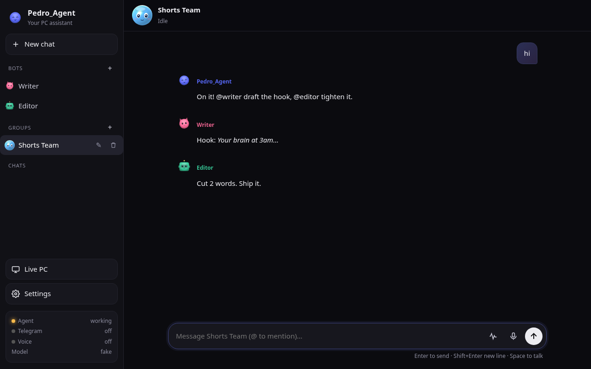
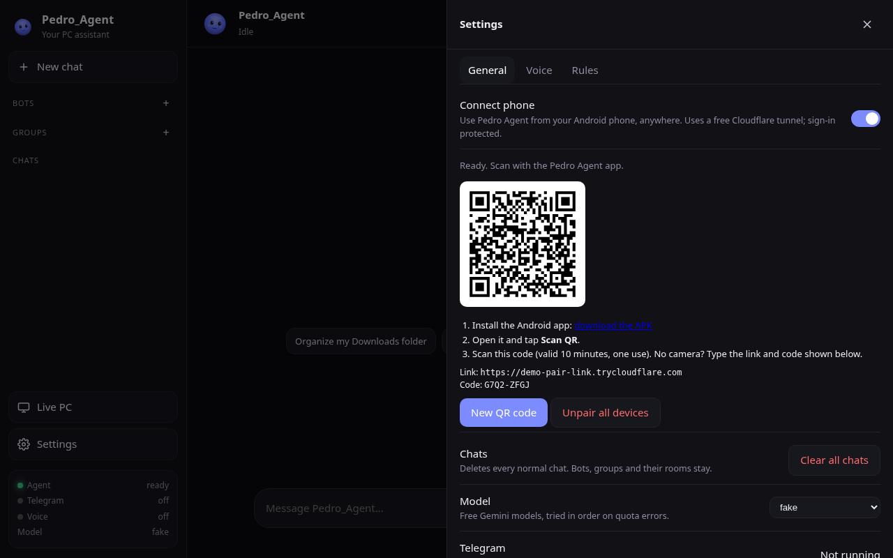
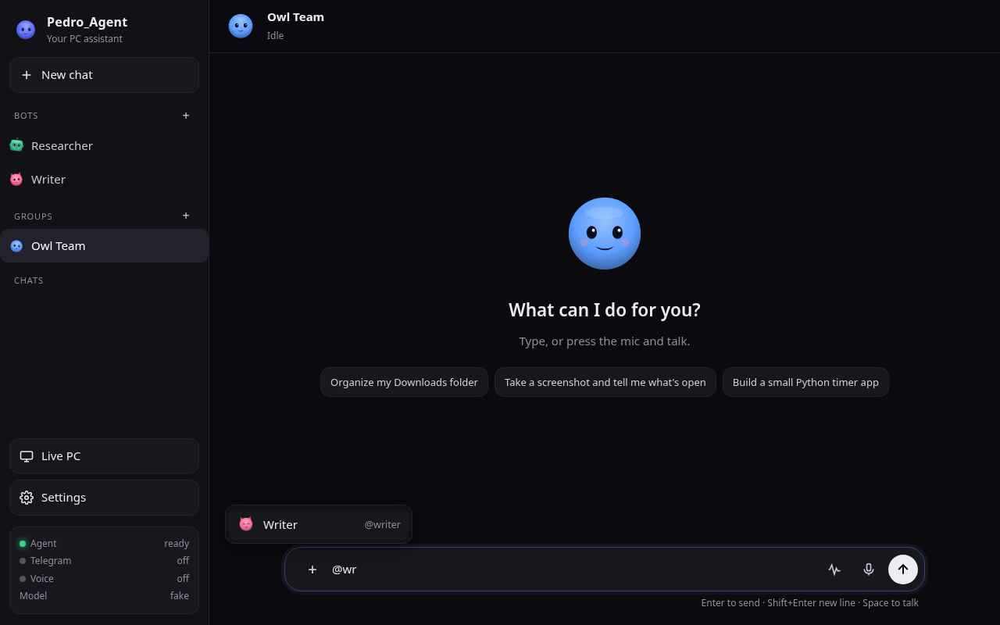
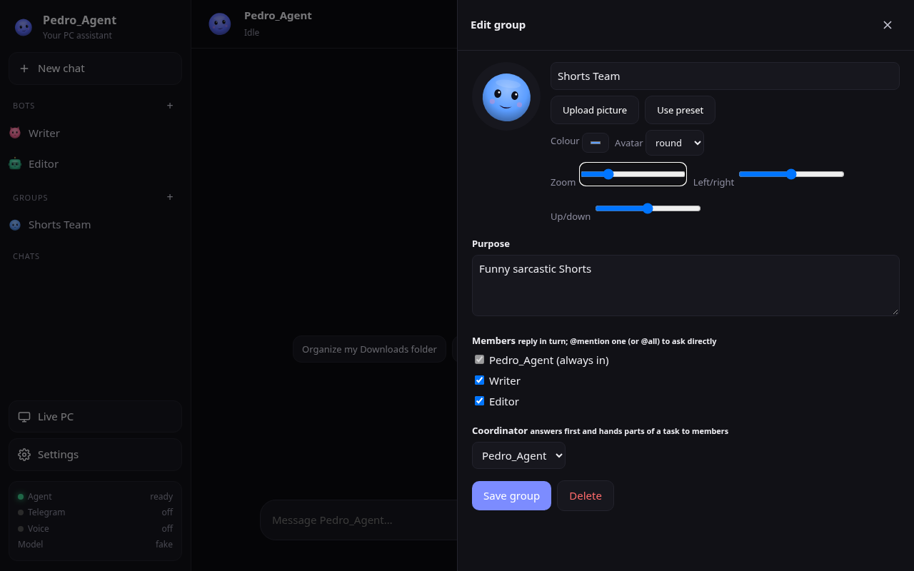

<p align="center"></p>

# Pedro_Agent

Your own AI assistant for Windows. Chat or talk to it, let it work on your PC, make custom bots and put them in group chats, and reach it from your phone. You only need a free Gemini API key.

<p align="center">
  <a href="https://github.com/lhymite36-bot/Pedro_Agent/releases/download/v1.4.3-windows/PedroAgent-Setup-1.4.3.exe"></a>
  &nbsp;
  <a href="https://github.com/lhymite36-bot/Pedro_Agent/releases/download/android-v1.3.0/PedroAgent-1.3.0.apk"></a>
</p>



## Set up in 3 steps

1. **Download and run** `PedroAgent-Setup-1.4.3.exe` (button above). No admin rights needed. If Windows SmartScreen warns you, click *More info → Run anyway* (the installer is not code-signed).
2. **Wait for setup.** It installs Python 3.12 if you don't have it, then the packages (a few minutes, needs internet). It adds *Pedro Agent* to your Desktop and Start menu.
3. **Open Pedro Agent and paste your free Gemini API key** (get one at https://aistudio.google.com/apikey). Telegram is optional. Keys are saved only in the `.env` file on your PC.

## Connect your phone

1. On your PC open **Pedro Agent › Settings › Connect phone** and switch it **on**. The first time it asks to download Cloudflare's free `cloudflared` tool. Click *Allow download*.
2. Install the [Android app (APK)](https://github.com/lhymite36-bot/Pedro_Agent/releases/download/android-v1.3.0/PedroAgent-1.3.0.apk) on your phone. Allow "install unknown apps" for your browser when Android asks.
3. Open the app, tap **Scan QR** and scan the code on your PC. The code works once and lasts 10 minutes. No camera? Type the link and the code shown under the QR.

After that the app finds your PC by itself, even when the link changes after a restart. **Unpair all devices** in the same Settings section signs out every phone.



## What you get

- Chat and voice assistant that can work on your PC. Risky actions (delete, pay, send, shut down…) ask you first.
- **Multi-step tasks, end to end**: ask for things like "read the assignment in Chrome, do it in Power BI, make a PDF with screenshots and send it to a classmate on WhatsApp". It plans a live checklist, works in your apps (Store apps too), checks each step on screen with vision and retries, takes real screenshots, builds a PDF or Word file on your Desktop, and stages WhatsApp Web messages (it checks the contact name and **asks before sending**). Finished tasks can be saved as reusable routines. It refuses graded tests and exams. Works from chat, voice, the phone app and Telegram.
- **Custom bots** with their own role, colour, avatar, tools and scheduled tasks.
- **Groups that run projects**: put bots in a room with a purpose. The leader plans, assigns each step to a member (`ASSIGN @writer: …`), the member does it for real with its tools, and the leader reviews and continues until it posts **PROJECT DONE** with a summary and the full path of every file. Live status shows who is working on what; **Stop** halts it. A safety limit (40 turns / 30 minutes, `groups:` in `rules.yaml`) pauses and asks you to continue. Sends, deletes and purchases still wait for your yes.
- **Desktop window**: dark, frameless window with its own minimise/maximise/close buttons and the Pedro icon in the taskbar (no console, one copy at a time). Larger, Grok-style chat layout.
- **Live PC up to 30 fps**: pick 1/5/10/15/30 fps; the stream adapts quality to your connection. Real speed depends on your PC (a slow laptop may manage 15-20).
- **@mention picker**: in a group, press **+** in the message box or type **@** to pick a member (with avatar), or *@all*. Filter as you type, arrows + Enter to choose; works with taps on the phone. A message to one bot goes straight to it and that bot does the work itself.


- **Group pictures**: upload a photo from your PC or phone (crop with zoom/position) or pick a preset avatar and colour.
- **Delete anything you made**: trash icons on chats, bots and groups (hover on PC, always shown on phone), plus *Clear all chats* in Settings. Every delete asks first; Pedro_Agent itself can't be deleted. Deleting a bot removes it from its groups; deleting a group keeps its bots.
- **Phone app** (Android APK above) and a Live PC view. Off by default. Turn it on in Settings › Connect phone (see above).



## Safe defaults

- `rules.yaml` decides what the agent may do. It ships with safe defaults: it writes only in your user folder and its workspace, and confirmations are on.
- Autopilot, Gemini Live voice and remote/phone access are **off** until you turn them on.
- **No external drive needed.** Files go to your Desktop (documents you asked for) or `Documents\PedroAgent` (everything else). Name any folder in your user profile and it's used; a drive that isn't plugged in is skipped and the file is saved locally. The agent always tells you the full save path.
- Nothing personal is in this repo. Your chats, bots, groups, keys and tokens stay on your PC (`storage/`, `.env`).

## Update, repair, uninstall

- **Update:** run a newer installer over the old one. Your settings are kept.
- **Repair:** Start menu → Pedro Agent → *Repair Pedro Agent* (re-runs setup).
- **Uninstall:** Windows *Apps* list or Start menu → *Uninstall Pedro Agent*. It asks whether to keep your chats and keys.

## For developers

```powershell
git clone https://github.com/lhymite36-bot/Pedro_Agent.git
cd Pedro_Agent
setup.bat
.venv\Scripts\python.exe main.py --app
```

Build the installer with NSIS: `makensis installer/PedroAgent.nsi` (output in `dist/`). Full feature notes: [docs/DETAILS.md](docs/DETAILS.md).

## If Windows or your antivirus warns

Pedro Agent is free and open source, and the installer is **not code-signed** yet (signing certificates cost money). New unsigned installers have no "reputation", so Windows and some antivirus programs warn about them, especially because a PC assistant legitimately does things that look powerful (it runs PowerShell to set up Python, can control the mouse/keyboard when you ask, and can download Cloudflare's tunnel when you turn on phone access).

- **SmartScreen "Windows protected your PC"**: click *More info* → *Run anyway*.
- **Chrome/Edge "unverified/dangerous download"**: open Downloads, choose *Keep* / *Keep anyway*.
- **Antivirus "virus found"**: this is a false positive on an unsigned installer. You can check the file yourself: compare its SHA-256 with the one on the release page, or upload it to [VirusTotal](https://www.virustotal.com).
- **Prefer no .exe at all?** Download the **portable ZIP** (`PedroAgent-1.4.3-portable.zip`) from the release page instead. It's just the source code plus `setup.bat`, a short batch file you can read in Notepad. Unzip it, double-click `setup.bat` (it shows everything it does), then open `Start Pedro Agent.cmd`. It needs Python 3.10–3.12 from python.org.

What the installer does: copies the app to `%LOCALAPPDATA%\PedroAgent` (no admin rights), runs the same plain `setup.bat` in a **visible** window (no PowerShell; if Python is missing it opens python.org for you, it never downloads or runs an .exe itself), installs the Python packages with pip, and creates Start menu/Desktop shortcuts. Nothing runs at Windows startup, and remote/phone access, autopilot and live voice are off until you turn them on.

